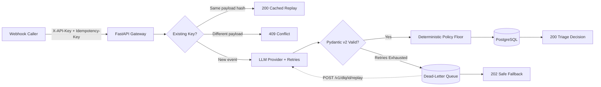

# agent-ops-gateway

Production-shaped **FastAPI + Pydantic v2 + PostgreSQL** webhook and AI-triage gateway. Designed for IT and operations teams that want LLM-assisted ticket routing without trusting unvalidated model output or losing events when an upstream provider fails.



## Engineering Guarantees

* **Strict Idempotency (`Idempotency-Key` + canonical SHA-256 hash):** Duplicate deliveries replay the stored decision without re-calling the LLM. Reusing a key with a modified body returns `409 Conflict`.
* **Pydantic v2 Schema Guardrails (`extra="forbid"`):** Both incoming webhooks and raw LLM JSON output are strictly validated before hitting the database.
* **Deterministic Policy Floor:** Even if the LLM returns `requires_human_approval: false`, Python code forces `requires_human_approval: true` whenever `severity == "critical"` or `confidence < CONFIDENCE_THRESHOLD` (`0.70`), flagging `policy_overridden: true`.
* **Retry + Dead-Letter Queue (DLQ) + Replay:** Provider timeouts, 5xx errors, or malformed JSON retry with exponential backoff. If retries exhaust, the raw event and exact error are persisted atomically to `dead_letter_jobs` and the caller receives `202 Accepted` with a deterministic `manual-triage` fallback. Once the provider recovers, `POST /v1/dlq/{job_id}/replay` re-processes the job and updates the event.
* **Zero-Key Local Execution:** Ships with `LLM_MODE=mock` by default so the full Docker Compose + PostgreSQL 17 stack can be verified locally without external API keys. Switch to `LLM_MODE=openai` with `LLM_API_KEY` for live OpenAI-compatible endpoints.
* **Sync DB Safety:** Route handlers use standard `def` with SQLAlchemy 2.0 + `psycopg` v3 so FastAPI dispatches blocking DB/HTTP I/O to its worker threadpool instead of stalling the event loop.

## 2-Minute Quick Start (Docker Compose)

```bash
docker compose up --build -d
curl -s http://localhost:8000/health
```

Submit an incident (triggers the deterministic policy floor on `critical`):

```bash
curl -s -X POST http://localhost:8000/v1/events/triage \
  -H "Content-Type: application/json" \
  -H "X-API-Key: dev-local-key" \
  -H "Idempotency-Key: inc-001" \
  -d '{"source":"pagerduty","title":"Production DB outage","body":"Primary database unreachable for 3 minutes"}'
```

Inspect metrics or failed jobs:

```bash
curl -s http://localhost:8000/metrics
curl -s -H "X-API-Key: dev-local-key" http://localhost:8000/v1/dlq
```

## Local Development & Verification

```bash
python3 -m venv .venv && source .venv/bin/activate
pip install -e ".[dev]"
ruff check .
mypy --strict src tests
pytest -v
```

CI runs `ruff`, `mypy --strict`, and `pytest` against both SQLite and a live `postgres:17-alpine` container on every push.

## AI Workflow Disclosure

Initial implementation was accelerated with CLI coding agents, with architecture, security boundaries, failure-path tests, and strict static checks (`ruff`, `mypy --strict`, live PostgreSQL CI) verified directly by execution.
